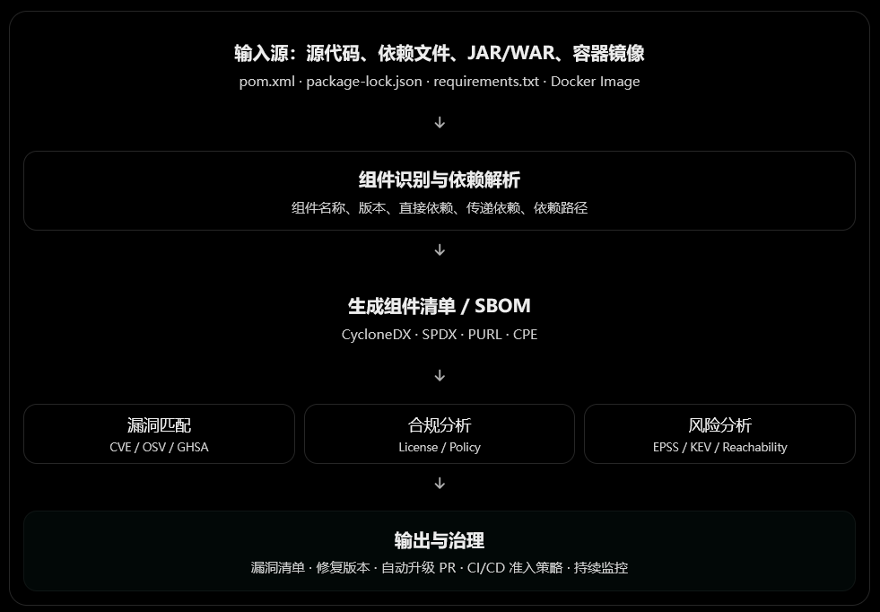
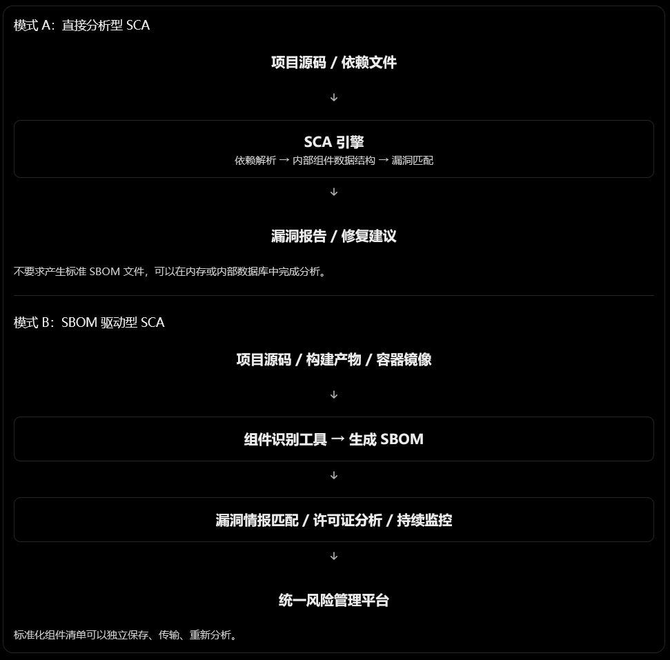
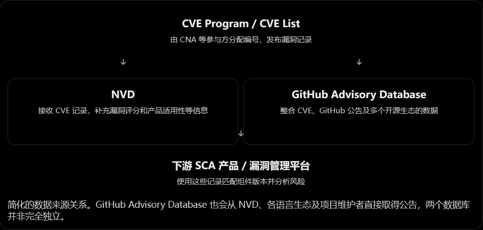
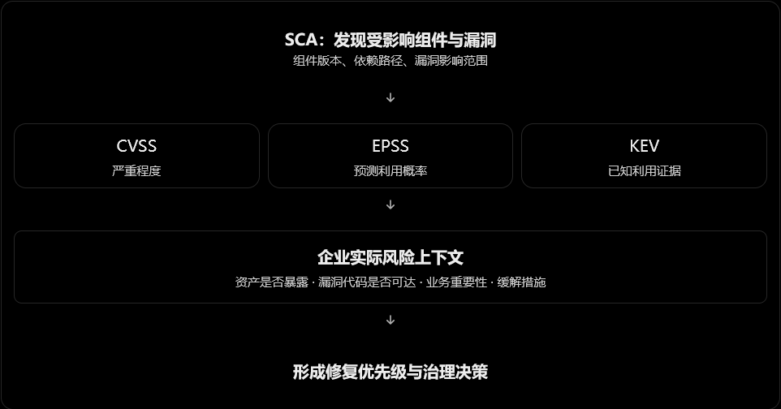
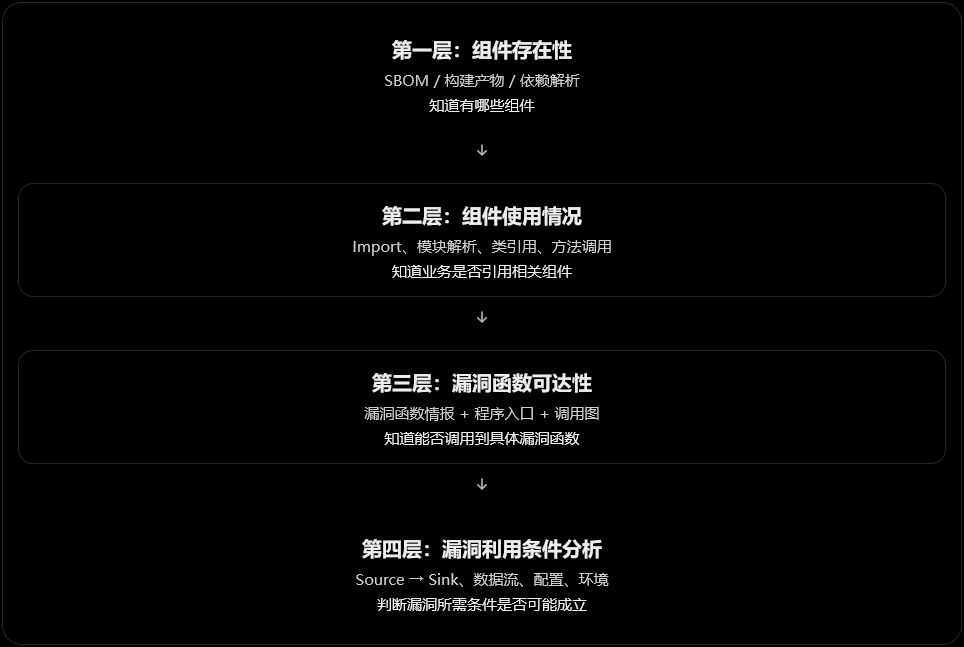
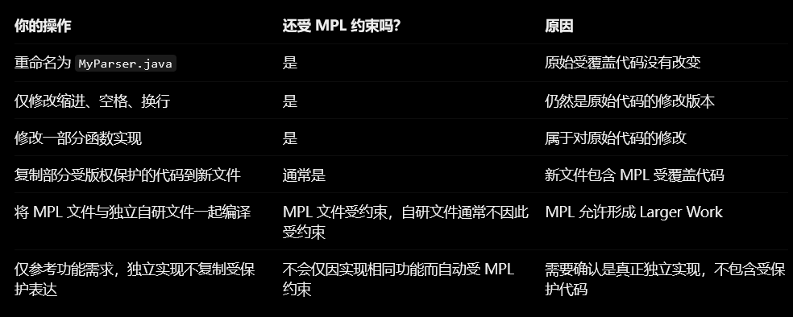

> 声明：
>
> - 本文只整理我在入门阶段遇到的核心术语和标准，后续遇到新的再补充
> - 只是整理核心术语，没有大段说明解释，因此理解需要具备一定的相关知识储备

## 零、SCA的基本工作流程



## 一、组件识别与依赖管理

这一组比较简单，不做过多解释

| 术语                  | 中文                 | 含义                                       |
| --------------------- | -------------------- | ------------------------------------------ |
| OSS                   | 开源软件             | Open Source Software，SCA 的主要分析对象   |
| Component / Package   | 组件 / 软件包        | 构成软件的第三方代码单元                   |
| Dependency            | 依赖                 | 项目运行、编译或测试所需要的组件           |
| Direct Dependency     | 直接依赖             | 开发者在项目中显式声明的依赖               |
| Transitive Dependency | 传递依赖（间接依赖） | 由其他依赖自动引入的组件                   |
| Dependency Graph      | 依赖图               | 描述**组件之间**依赖关系的有向图           |
| Dependency Path       | 依赖路径             | 用于说明**问题**组件通过哪条**链路**被引入 |
| Manifest              | 依赖声明文件         | 如 `pom.xml`、`package.json`               |
| Lockfile              | 依赖锁定文件         | 记录实际解析版本，如 `package-lock.json`   |
| Vendored Dependency   | 内嵌第三方依赖       | 将第三方代码直接复制到仓库内部             |
| Package Registry      | 软件包仓库           | 如 Maven Central、npm、PyPI                |

## 二、组件标识与 SBOM 标准

| 术语            | 中文               | 含义                                                         |
| --------------- | ------------------ | ------------------------------------------------------------ |
| **SBOM**        | 软件物料清单       | Software Bill of Materials，软件组件清单                     |
| **CycloneDX**   | SBOM 标准格式      | OWASP 发起、偏重供应链安全场景的 BOM 标准                    |
| **SPDX**        | 软件包数据交换标准 | Linux Foundation 发起，广泛用于许可证及软件供应链信息交换    |
| **PURL**        | 软件包 URL 标识    | Package URL，统一描述软件包的生态、名称、版本等<br />例子：pkg:maven/org.apache.logging.log4j/log4j-core@2.14.1 |
| **CPE**         | 通用平台枚举       | Common Platform Enumeration，NVD 等使用的软件/产品命名体系   |
| **SWID**        | 软件标识标签       | Software Identification Tags，用于软件识别与资产管理         |
| Package Hash    | 软件包哈希         | 对组件文件进行完整性校验和辅助识别                           |
| SBOM Ingestion  | SBOM 导入          | 将外部生成的物料清单交给平台分析                             |
| SBOM Enrichment | SBOM 信息增强      | 为清单补充漏洞、许可证和风险等信息                           |

### 进一步解释

#### PURL：给软件包定义统一的身份

PURL负责回答"**这是哪个软件包、属于什么生态、是什么版本？**" ，广泛用于：

- SBOM 的组件身份记录
- SCA 漏洞数据库查询
- 依赖安全公告
- 软件包清单关联
- 多语言、多包管理器之间的信息交换

标准格式如下：

```
scheme:type/namespace/name@version?qualifiers#subpath
```

| 部分       | 必需 | 含义                              |
| ---------- | ---- | --------------------------------- |
| scheme     | 是   | 固定为 `pkg`                      |
| type       | 是   | 包所属的生态，如 maven、npm、pypi |
| namespace  | 否   | 命名空间、组织或分组              |
| name       | 是   | 软件包名称                        |
| version    | 否   | 软件包版本                        |
| qualifiers | 否   | 架构、发行渠道、包类型等附加条件  |
| subpath    | 否   | 包中的内部路径                    |

例子：

```
# Python 包
pkg:pypi/requests@2.31.0

# npm 无作用域包
pkg:npm/lodash@4.17.21

# npm 有作用域包
pkg:npm/%40angular/core@17.0.0

# Maven 包，带 packaging 限定条件
pkg:maven/org.apache.logging.log4j/log4j-core@2.14.1?type=jar
```

#### CPE：给 IT 产品建立统一命名体系

CPE 的目标是让不同工具**对同一 IT 产品类别拥有可以共享和比较的名称**

标准格式如下：

```
cpe:2.3:part:vendor:product:version:update:edition:language:sw_edition:target_sw:target_hw:other
```

| 部分       | 必需           | 含义                             |
| ---------- | -------------- | -------------------------------- |
| part       | 产品类型       | `a` 应用、`o` 操作系统、`h` 硬件 |
| vendor     | 厂商           | 如microsoft                      |
| product    | 产品名         | 如internet_explorer              |
| version    | 产品版本       | 如8.0.6001                       |
| update     | 更新或补丁级别 | beta                             |
| edition    | 产品版本类别   | 如企业版                         |
| language   | 语言           | 如 `en-us`                       |
| sw_edition | 软件发行类别   | 与软件发行版本相关               |
| target_sw  | 目标软件环境   | 如 Windows                       |
| target_hw  | 目标硬件环境   | 如 x64                           |
| other      | 其他属性       | 扩展信息                         |

##### CPE与PURL的区别

以log4j-core为例，`org.apache.logging.log4j:log4j-core:2.14.1`可表示为：

- PURL: `pkg:maven/org.apache.logging.log4j/log4j-core@2.14.1`
- CPE: `cpe:2.3:a:apache:log4j:2.14.1:*:*:*:*:*:*:*`

这其实会导致一个问题，apache的log4j有多个组件，如log4j-core、log4j-api等，然而CPE却还在NVD中被使用，这就成为了SCA的部分误报来源

#### SWID：不仅给软件起名字，还要描述软件本身

企业管理中，在扫描员工电脑安装了什么软件时，传统方式可能通过扫描注册表、文件名、安装目录或者进程来猜测。但这些识别方式可能不准确。例如，`app.exe` 并不能可靠地说明它属于哪个厂商的哪个产品。于是出现了一个想法：

**能不能为软件提供一个标准化的、机器可以读取的软件身份标签？**

SWID 就是为这类需求设计的。

一个参考例子如下，描述的是一款名为 Order Service、版本为 1.0.0 的软件，由 Example Corporation 创建，并包含一个名为 order-service.jar 的文件

```xml
<SoftwareIdentity
  xmlns="http://standards.iso.org/iso/19770/-2/2015/schema.xsd"
  name="Order Service"
  tagId="com.example.order-service-1.0.0"
  version="1.0.0">

  <Entity
    name="Example Corporation"
    regid="example.com"
    role="tagCreator softwareCreator"/>

  <Payload>
    <File name="order-service.jar"/>
  </Payload>

</SoftwareIdentity>
```

#### CycloneDX：把整个软件及其组成关系写成清单

前面的标准分别解决了包身份、产品名称、软件身份与相关信息描述问题等针对单个组件/软件的标准。但是，一个现代应用可能使用数百个依赖，一个依赖又包含数个依赖，这就需要一个能够**记录整个软件构成**的标准。一个简单的CycloneDX如下所示

```json
{
  "bomFormat": "CycloneDX",
  "specVersion": "1.7",
  "version": 1,
  "metadata": {
    "component": {
      "type": "application",
      "bom-ref": "order-service",
      "name": "Order Service",
      "version": "1.0.0",
      "swid": {
        "tagId": "com.example.order-service-1.0.0",
        "name": "Order Service",
        "version": "1.0.0"
      }
    }
  },
  "components": [
    {
      "type": "library",
      "bom-ref": "log4j-core",
      "group": "org.apache.logging.log4j",
      "name": "log4j-core",
      "version": "2.14.1",
      "purl": "pkg:maven/org.apache.logging.log4j/log4j-core@2.14.1"
    }
  ],
  "dependencies": [
    {
      "ref": "order-service",
      "dependsOn": ["log4j-core"]
    },
    {
      "ref": "log4j-core",
      "dependsOn": []
    }
  ]
}
```

CycloneDX 里出现了 PURL，也出现了 SWID，甚至也允许出现CPE。它主要有以下几个部分

- Metadata：这份清单描述哪个应用？由哪个工具生成？
- Components：应用包含哪些库？各是什么版本？
- Dependencies：组件之间有哪些依赖关系？
- 其他字段：如components[i].licenses表示开源许可证，vulnerabilities表示漏洞等

#### SPDX：另一套独立的组件和供应链信息标准

Software Package Data Exchange/System Package Data Exchange。SPDX更**侧重许可证合规和来源追溯**

```json
{
  "spdxVersion": "SPDX-2.3",
  "dataLicense": "CC0-1.0",
  "SPDXID": "SPDXRef-DOCUMENT",
  "name": "Order Service SBOM",
  "documentNamespace": "https://example.com/spdx/order-service-1.0.0",
  "creationInfo": {
    "created": "2026-11-01T00:00:00Z",
    "creators": [
      "Organization: Example Corporation"
    ]
  },
  "documentDescribes": [
    "SPDXRef-OrderService"
  ],
  "packages": [
    {
      "SPDXID": "SPDXRef-OrderService",
      "name": "Order Service",
      "versionInfo": "1.0.0",
      "downloadLocation": "NOASSERTION",
      "filesAnalyzed": false,
      "licenseDeclared": "NOASSERTION",
      "licenseConcluded": "NOASSERTION",
      "copyrightText": "NOASSERTION"
    },
    {
      "SPDXID": "SPDXRef-Log4jCore",
      "name": "log4j-core",
      "versionInfo": "2.14.1",
      "downloadLocation": "NOASSERTION",
      "filesAnalyzed": false,
      "licenseDeclared": "Apache-2.0",
      "licenseConcluded": "NOASSERTION",
      "copyrightText": "NOASSERTION",
      "externalRefs": [
        {
          "referenceCategory": "PACKAGE-MANAGER",
          "referenceType": "purl",
          "referenceLocator": "pkg:maven/org.apache.logging.log4j/log4j-core@2.14.1"
        }
      ]
    }
  ],
  "relationships": [
    {
      "spdxElementId": "SPDXRef-OrderService",
      "relationshipType": "DEPENDS_ON",
      "relatedSpdxElement": "SPDXRef-Log4jCore"
    }
  ]
}
```

### 常见问题

#### 1、SBOM的生成是必须的吗？

不是。SCA一般支持两种扫描模式，如下图所示，可以是直接分析，也可以先生成中间产物SBOM再进行匹配。注意，SBOM这个中间产物并不会让扫描更准确，而是提供了一个标准化的组件文件，使得生成SBOM组件清单和最终进行SCA分析两个过程可以独立，也就使得SCA产品更换、向第三方提供组件清单等变得更方便



#### 2、SBOM跟CycloneDX/SPDX的关系是什么？


#### 3、如何理解PURL、CPE、SWID、CycloneDX、SPDX这几个标准的关系？

##### 路线 A：IT 资产管理与漏洞管理

代表：CPE、SWID。

早期的大型企业关心：

- 公司购买了多少套商业软件？
- 某台服务器安装了什么软件？
- 操作系统及商业软件是否打了补丁？
- 某个 Windows 或 Apache 产品受到哪些漏洞影响？

这个时期，软件通常被视为一个个可安装、可管理的产品。

##### 路线 B：开源许可证与软件合规

代表：SPDX。

随着 Linux 和开源项目广泛进入商业软件，企业开始遇到新的问题：

- 软件包含哪些开源组件？
- 这些组件采用 MIT、GPL 还是 Apache 许可证？
- 组件被修改或分发后，需要履行什么义务？
- 上游供应商能否把这些信息以统一格式交付给下游？

SPDX 最初就是为了降低开源软件合规信息交换的成本。后来逐渐扩大到完整的 SBOM 和供应链信息。

##### 路线 C：现代依赖管理与软件供应链安全

代表：PURL、CycloneDX。

随着 npm、Maven、PyPI、NuGet 等包管理器普及，一个项目可能间接引入数百甚至数千个组件。

这时又出现不同的问题：

- Java 的 Maven 包和 Python 的 PyPI 包，怎样使用统一方式标识？
- 组件存在嵌套依赖，怎样表示依赖图？
- 新漏洞出现后，如何快速寻找受影响的软件？
- 不同 SCA 平台如何共享组件清单？

PURL 重点解决包标识问题，CycloneDX 重点解决软件组成及风险数据交换问题。

所以这五个标准的并存不是历史遗留的简单重复，而是它们各自针对的对象、信息粒度和使用场景不同。

#### 4、如何区分CycloneDX、SPDX 和 SWID？

注意，它们都能表示SBOM。但在使用场景下有所侧重：

- CycloneDX： 起源于**应用安全与软件成分分析**，侧重软件组成透明性、依赖关系、安全风险及供应链信息交换。

- SPDX： 起源于**开源许可证合规**，侧重组件、文件、许可证、版权、来源及供应链关系的标准化交换。如今也支持安全、构建及其他领域。

- SWID： 起源于**软件资产管理**，侧重软件产品的身份、安装状态、补丁和软件生命周期。

从工作岗位角度来理解：

- **CycloneDX：应用安全工程师**
  - 开发了一个 Java 应用，需要知道里面有哪些第三方组件、它们如何依赖、是否存在漏洞，以及组件是否受到特定漏洞影响。
  - 典型场景：SCA、SBOM、VEX、漏洞治理、供应链安全。

- **SPDX：开源合规与软件交付工程师**
  - 要将软件交付给客户，需要清楚说明包含哪些开源包、哪些文件属于它们、采用什么许可证、版权归谁、组件来自哪里。
  - 典型场景：许可证合规、软件供应商交付、组件溯源、SBOM 交换。

- **SWID：IT 资产管理员**
  - 管理企业 1000 台电脑，需要识别安装了哪些软件、具体版本是什么、补丁有没有安装，以及软件卸载或升级后如何更新资产。
  - 典型场景：软件资产管理（SAM）、安装资产盘点、补丁管理、许可证资产管理。

## 三、漏洞情报与风险评分

| 术语              | 中文                     | 含义                                        |
| ----------------- | ------------------------ | ------------------------------------------- |
| **CVE**           | 通用漏洞披露编号         | 标识一个公开披露的漏洞                      |
| **CWE**           | 通用弱点枚举             | 对软件缺陷类型进行分类。如CWE-89表示SQL注入 |
| NVD               | 美国国家漏洞数据库       | 提供漏洞及相关丰富化信息                    |
| GHSA              | GitHub 安全公告编号      | GitHub Advisory Database 的漏洞标识         |
| OSV               | 开源漏洞数据库及数据格式 | 面向开源生态的漏洞信息交换和查询            |
| **CVSS**          | 通用漏洞评分系统         | 衡量漏洞技术严重程度                        |
| **EPSS**          | 漏洞利用预测评分系统     | 预测漏洞近期被真实利用的概率                |
| **KEV**           | 已知被利用漏洞目录       | CISA 维护的已知遭利用漏洞清单               |
| Affected Versions | 受影响版本范围           | 说明哪些组件版本可能存在漏洞                |
| Fixed Version     | 修复版本                 | 已修复该漏洞的版本或版本范围                |
| Backport          | 补丁回移                 | 将修复代码移植到较早的维护版本              |
| Exploitability    | 可利用性                 | 漏洞在具体条件下被成功利用的可能性          |

### 进一步解释

#### EPSS

EPSS 的本质：基于机器学习的漏洞利用概率预测。其表示形式如下，主要包含epss和percentile两个核心数值

```json
{
  "cve": "CVE-2026-12345",
  "epss": "0.120000",
  "percentile": "0.970000",
  "date": "2026-11-05"
}
```

- `epss = 0.12`：预测未来 30 天出现可观测利用活动的概率为 12%（注意，不意味着在未来 30 天有 12% 的概率被攻击）
- `percentile = 0.97`：该分数高于或等于约 97% 的已评分漏洞（注意，不意味着有 97% 的利用概率）
- `date`：该预测结果对应的日期

#### KEV

KEV（Known Exploited Vulnerabilities）是美国 CISA 维护的已知遭利用漏洞目录，主要价值是**提供一种相对可信的历史利用事实信号**，其相关情报主要来自安全厂商与研究人员、政府和国际合作伙伴、公开情报、威胁监测与商业情报、事件响应与取证等

KEV的收录需要满足以下条件：

- 漏洞拥有 CVE 编号
- 有可靠证据证明漏洞曾在真实环境中被攻击者利用
- 存在明确的修复或缓解措施

KEV只有有和无的情况，或者说只区分某个CVE有没有过真实利用的证据。以下是KEV的一个简化例子

```json
{
  "cveID": "CVE-YYYY-NNNN",
  "vendorProject": "Example Vendor",
  "product": "Example Product",
  "vulnerabilityName": "Example Vulnerability",
  "dateAdded": "2026-11-01",
  "shortDescription": "Example description",
  "requiredAction": "Apply the vendor remediation",
  "dueDate": "2026-11-15",
  "knownRansomwareCampaignUse": "Unknown"
}
```

- `dateAdded` 是加入目录的日期，不是漏洞首次被攻击的日期
- `dueDate` 属于美国联邦机构的相关整改期限信息，不是可以直接拿来使用的漏洞SLA时间
- `knownRansomwareCampaignUse: "Unknown"` 代表勒索软件活动关联情况未知，不代表漏洞未被利用

需要注意，KEV只是尽可能收录了被证明存在利用证据的CVE漏洞而已：

- 未进入 KEV ≠ 未被利用
- 进入 KEV ≠ 此时此刻仍在被大量利用

### 常见问题

#### 1、NVD和GitHub Advisory Database的关系是什么，谁收录的漏洞更完整？

可以算是并列关系，但是各自的侧重不同：

- NVD 是美国 NIST 维护的漏洞数据库，覆盖了具有 CVE 编号的软硬件漏洞
- GitHub Advisory Database 是 GitHub 维护的安全公告聚合数据库，特别关注开源软件包漏洞与恶意包，对于组件漏洞的覆盖比NVD更广，除了NVD本身漏洞外，还收录经过 GitHub 审核的漏洞公告和恶意软件包公告的漏洞



然而，目前没有证据能够证明某一个公开数据库在所有软件生态、所有漏洞类型及所有时间窗口中都最完整，主要原因有：

- 不是所有真实漏洞都会公开披露或分配 CVE
- 不同平台的覆盖对象不同，例如NVD 更偏通用产品，GitHub 和 OSV 更贴近开源包生态，并且不同开源包生态平台自身一般又有很大可能收录了其他平台没有的漏洞

因此，当前的最佳实践是：以多来源漏洞情报作为基础，优先使用软件包生态的精确影响范围，再结合 CVE/NVD 和上游厂商公告校验，并通过 CVE、GHSA、OSV 别名进行去重

#### 2、如何理解CVSS、EPSS、KEV的关系

| 指标 | 衡量什么                         | 适合回答的问题                                         |
| ---- | -------------------------------- | ------------------------------------------------------ |
| CVSS | 漏洞的技术严重程度               | 漏洞一旦被利用，会有多严重？对应的是一个评分和漏洞定级 |
| EPSS | 未来 30 天在野利用活动的预测概率 | 这个漏洞近期可能被攻击者利用吗？                       |
| KEV  | 是否已被确认在野利用             | 是否已有该漏洞遭利用的证据？                           |

> EPSS 不代表特定企业一定会遭受攻击，KEV 也不能覆盖所有已被利用的漏洞

CVSS、EPSS、KEV三者衡量的问题维度不同，但共同为现代企业组件漏洞风险管理提供考量依据



## 四、SCA 漏洞研判与降噪术语

| 术语                        | 中文                 | 含义                                           |
| --------------------------- | -------------------- | ---------------------------------------------- |
| Reachability Analysis       | **可达性分析**       | 判断应用代码是否能够调用到存在漏洞的组件或函数 |
| Call Graph                  | **调用图**           | 描述函数之间的调用关系                         |
| Function-Level Reachability | **函数级可达性**     | 判断具体漏洞函数能否被调用                     |
| Dataflow Reachability       | **数据流可达性**     | 不可信输入能否流入漏洞位置，并满足触发条件     |
| Runtime Reachability        | **运行时可达性**     | 结合实际运行行为分析漏洞代码是否被执行         |
| Contextual Analysis         | 上下文分析           | 结合资产、执行环境、代码调用和漏洞条件评估风险 |
| False Positive              | 误报                 | 工具报告了实际不存在或不适用的问题             |
| False Negative              | 漏报                 | 实际存在的问题未被工具发现                     |
| **VEX**                     | 漏洞可利用性信息交换 | 以机器可读形式表达某产品是否受特定漏洞影响     |
| Remediation                 | 漏洞修复             | 升级依赖、替换组件、应用补丁等                 |
| Mitigation                  | 风险缓解             | 在尚未根治问题时采取补偿性措施                 |
| Suppression / Waiver        | 抑制 / 豁免          | 按政策隐藏、排除或接受特定风险                 |

### 进一步解释

#### 漏洞组件可达性

- 依赖级可达：业务代码是否使用该组件
- 函数级可达：业务代码能否执行到具体的漏洞函数
- 数据流可达：业务代码存在一条外部输入可达的漏洞数据流传播路径。数据流可达性已经非常贴近真实漏洞成立条件，但是仍然不代表一定存在漏洞。例如，虽然数据流可达，但漏洞的前置触发条件并不满足
- 运行时可达：在动态运行状态下是否可观测到漏洞被利用。可观测到证明漏洞实际可达，但不可观测到无法证明漏洞就不可达，有可能是缺少特定的触发条件

注意：

1、依赖声明中存在组件≠依赖级可达，很多SCA工具是只做到组件存在检测，而没有做到依赖级可达检测的

2、组件存在漏洞 ≠ 漏洞函数一定可达 ≠ 漏洞一定可以被利用

3、函数级可达、数据流可达和运行时可达分析其实是降噪手段，即使**检测不出来也不意味着就绝对没问题**。例如，由于语言的高级特性（反射、动态加载等），完全可能存在函数级可达和数据流可达分析找不到的情况



#### VEX

VEX 全称是 Vulnerability Exploitability eXchange（漏洞可利用性信息交换），是一种**机器可读的信息机制**，用于**声明软件产品或组件针对特定漏洞的影响状态**。

使用大白话来说就是，描述了某个产品某个漏洞的状态如何。如下所示是一个简化版VEX样例，它描述的是：order-service 1.0.0中所使用的组件library-a 1.0.0存在的CVE-2099-12345漏洞的状态是不受影响。

```json
{
  "@context": "https://openvex.dev/ns/v0.2.0",
  "@id": "https://example.org/vex/order-service-1",
  "author": "Example Security Team",
  "timestamp": "2026-11-10T00:00:00Z",
  "version": 1,
  "statements": [
    {
      "vulnerability": {
        "name": "CVE-2099-12345"
      },
      "products": [
        {
          "@id": "pkg:maven/com.example/order-service@1.0.0",
          "subcomponents": [
            {
              "@id": "pkg:maven/com.example/library-a@1.0.0"
            }
          ]
        }
      ],
      "status": "not_affected",
      "justification": "vulnerable_code_not_in_execute_path",
      "impact_statement": "Analysis confirmed that the vulnerable function is not reachable from the application's execution paths."
    }
  ]
}
```

VEX中常见的状态有：

- affected：受到影响
- not_affected：不受影响
  - component_not_present：产品中没有该漏洞组件
  - vulnerable_code_not_present：组件可能存在，但漏洞代码不在产物中
  - vulnerable_code_not_in_execute_path：漏洞代码无法通过产品执行路径触达
  - vulnerable_code_cannot_be_controlled_by_adversary：攻击者无法控制漏洞触发所需的条件
  - inline_mitigations_already_exist：产品内置了能阻止漏洞利用的防护机制
- fixed：已修复
- under_investigation：调查中

总的来说，VEX就是在SCA进行可达性等分析过后，由机器对具体产品所依赖的具体组件的具体漏洞的状态做出判断并生成的标准结果，最后交由人类工程师进行确认。它有一个重要用途，就是减少软件供应商与下游用户之间的重复漏洞分析

### 常见问题

1、采用生成SBOM的方式，得到的组件列表就算实际组件级可达性的列表了吗？如果不是的话，那组件可达性要怎么做？

2、各个地方直接收集到的漏洞危险函数可能仍然不准确并且无法构成自动化流程，能不能用Agent形成自动整理漏洞危险函数并自动编写检查规则的自动化流程，从实际可行性角度出发分析一下，难度有多高？以前，这部分工作往往是由乙方安全厂商在做的，由于可以向成百上千甲方公司提供，所以对他们来说招一些人来做这个事情是很有必要的，但是我们是甲方公司，并且安全预算不足，无法直接采购商业产品，这种情况到底有没有办法建设起自己的函数可达性甚至是数据流可达性分析？

3、VEX是不是主要就是标记具体组件漏洞在当前产品中的状态的，从而避免其他扫描器或者平台再报告这个漏洞导致浪费研判人力？那SAST中为什么没有这样的标准呢，SAST都是生成漏洞指纹，然而不同工具的指纹生成算法又是不同的

#### 在企业实际工作中，如何权衡可达性？

| 分析方式         | 成本   | 降噪精度                   | 主要局限                     | 建议定位           |
| ---------------- | ------ | -------------------------- | ---------------------------- | ------------------ |
| 依赖存在性检测   | 低     | 低                         | 组件存在不代表被使用         | 全量基础扫描       |
| 组件级可达性     | 低～中 | 中                         | 无法区分安全函数与漏洞函数   | 全量初筛或重点项目 |
| 函数级静态可达性 | 中～高 | 较高                       | 需要漏洞函数情报和可靠调用图 | 高风险漏洞重点分析 |
| 数据流可达性     | 高     | 高，通常更接近实际利用条件 | 规则及跨框架分析复杂         | 严重漏洞专项       |
| 运行时可达性     | 中～高 | 对已观测执行路径证据强     | 覆盖率、部署和探针维护问题   | 核心系统补充验证   |

这里有个重要的判断：**函数级分析不是组件级分析的替代品，运行时分析也不是函数级静态分析的替代品**

适合的组合通常是：**全量依赖识别 → 组件级使用情况 → 重点漏洞函数级分析 → 必要时数据流和运行时验证**

## 五、开源许可证与法律合规

SCA除了需要重点检查组件漏洞外，在商业闭源应用中引入的开源组件对应的协议也是值得关注的，尤其是出现违规使用同时没有替代组件的情况下，法律风险就会很高了。人家不一定要你付费，而是要求你开源代码。

| 术语                  | 中文                    | 含义                                         |
| --------------------- | ----------------------- | -------------------------------------------- |
| OSS License           | 开源许可证              | 规定开源软件使用、修改、再分发的条件         |
| Permissive License    | 宽松型许可证            | 如 MIT、Apache-2.0、BSD                      |
| Copyleft              | 著佐权 / 传染性许可机制 | 在特定修改、组合和分发情形下产生相应开源义务 |
| Weak Copyleft         | 弱 Copyleft             | 如 LGPL，通常具有相对有限的适用范围          |
| License Compatibility | 许可证兼容性            | 多个开源许可证的义务能否同时满足             |
| Dual Licensing        | 双重许可                | 同一组件提供不同许可证选择                   |
| License Policy        | 许可证使用策略          | 企业允许、限制或禁止使用哪些许可证           |
| Attribution / Notice  | 署名 / 声明义务         | 按许可证要求保留版权及许可声明               |

### 进一步解释

#### 常见开源License对比

| License        | 类型                          | 可否闭源商用                     | 分发时是否要提供源码                      | 核心要求                                                     |
| -------------- | ----------------------------- | -------------------------------- | ----------------------------------------- | ------------------------------------------------------------ |
| MIT            | 宽松型（非Copyleft）          | 可以                             | 不需要                                    | 保留版权声明和许可文本                                       |
| BSD-2-Clause   | 宽松型                        | 可以                             | 不需要                                    | 保留版权声明、许可条件及免责声明                             |
| BSD-3-Clause   | 宽松型                        | 可以                             | 不需要                                    | BSD-2 要求 + 不得擅自使用原作者名义背书                      |
| ISC            | 宽松型                        | 可以                             | 不需要                                    | 保留版权与许可声明                                           |
| Apache-2.0     | 宽松型                        | 可以                             | 不需要                                    | 保留声明、许可证、必要的 NOTICE；<br />标明修改；**包含明确专利授权** |
| MPL-2.0        | 弱 Copyleft（文件级）         | 可以                             | 需要提供受 MPL 约束的源文件               | 修改过的 MPL 文件仍受 MPL 约束，新建独立文件可采用其他许可   |
| EPL-2.0        | 弱 Copyleft                   | 可以，有条件                     | 分发受 EPL 约束的软件时需提供相应源码     | 保留原有权利，遵守受覆盖程序的源码分发要求                   |
| LGPL-2.1 / 3.0 | 弱 Copyleft（库级）           | 可以，有条件                     | 需按许可提供受 LGPL 约束的库源码          | 保留声明、遵守库的修改及重新链接等要求                       |
| GPL-2.0        | 强 Copyleft                   | 组合分发通常受限制               | 通常需要提供整个受 GPL 约束作品的对应源码 | 受 GPL 约束的组合作品分发时须遵守 GPL                        |
| GPL-3.0        | 强 Copyleft                   | 组合分发通常受限制               | 同上                                      | GPL-2.0 的核心要求，并有更明确的专利与特定设备安装信息条款   |
| AGPL-3.0       | 强 Copyleft（含网络交互要求） | 组合分发或特定网络服务有较强限制 | 分发以及特定网络服务场景可能触发          | 修改版通过网络与用户交互时，需按规定提供对应源码             |

### 常见问题

#### 1、Copyleft和Copyright的区别是什么？

Copyright 是著作权（版权），Copyleft 是利用著作权实现的一种许可机制，产生于Copyright之上

例如，下面这有一段声明，就提到了Copyright所属以及通过GPL-2.0开源，在保留著作权的基础上，进行有限开源许可就产生Copyleft

```
Copyright © 2026 Example Corporation
Licensed under the GPL-2.0 License.
```

#### 2、MPL协议中，能不能把原本的MPL文件改名和做一定量的代码文本格式化，这样就算新的文件了，就不受约束？

不能，MPL协议明确规定以下两种情况属于修改行为

- 对已有 MPL 代码进行增加、删除或修改而产生的源文件
- 任何包含原有 MPL 受覆盖代码的新源文件



> 最后一种情况需要注意：简单替换变量名、调整函数顺序、改写代码风格，不等于独立实现

#### 3、如果该产品后续更换了开源协议甚至删除代码仓库了，之前的版本还能按照之前的开源协议进行使用吗？特别是其删除/隐藏代码仓库的情况该怎么处理？

通常可以。这里最重要的法律原则是：已经合法授予的开源使用权，不会仅仅因为作者后来改变主意，就自动失效。

但要区分两件事：

- 授权是否仍然有效： 原来获得的合法使用权是否继续存在。这一点基本可以保障，一旦开源了一般就不能撤回，不会因为作者修改开源协议、删除代码仓库等行为就取消原本的开源授权
- 授权证据是否仍然存在： 你能否证明自己使用的组件版本当时确实采用该许可证。通常来说，虽然很多时候即使"授权证据"找不到也没有关系，但很难向法务、审计或客户证明使用行为具有合法授权依据，对于商业化产品来说风险就很高了

## 六、软件供应链攻击与治理

| 术语                  | 中文                   | 含义                                         |
| --------------------- | ---------------------- | -------------------------------------------- |
| Software Supply Chain | 软件供应链             | 软件从依赖引入到构建发布的完整链路           |
| Dependency Confusion  | 依赖混淆攻击           | 在公共仓库发布私有包同名公共包，引入恶意依赖 |
| Typosquatting         | 拼写混淆攻击           | 发布与热门软件包名称相似的恶意包             |
| Malicious Package     | 恶意软件包             | 本身包含恶意逻辑的依赖                       |
| Package Hijacking     | 软件包劫持             | 利用发布账号等控制权投放恶意版本             |
| Dependency Pinning    | 依赖版本固定           | 固定版本，减少不受控升级                     |
| Artifact Signing      | 构建产物签名           | 验证产物身份与完整性                         |
| **Provenance**        | 来源证明               | 描述产物如何、由什么来源构建                 |
| **SLSA**              | 软件制品供应链安全框架 | 提高软件构建、来源与完整性的可信程度         |
| Policy Gate           | 策略门禁               | 在开发、构建、发布阶段自动执行准入规则       |
| Continuous Monitoring | 持续监测               | 针对已经登记的组件持续匹配新出现的风险       |

SCA 与软件供应链安全的关系是：SCA 是软件供应链安全的重要组成部分，它的主要目的是做更细致的版本控制和许可证检查，因此不能覆盖所有供应链攻击，尤其是带有主观恶意的供应链攻击完全不是SCA能防护的。 例如，传统依赖漏洞扫描不一定能发现尚未公开披露的恶意软件包，因此逐渐出现了恶意行为分析、包来源验证、构建证明等补充能力。
